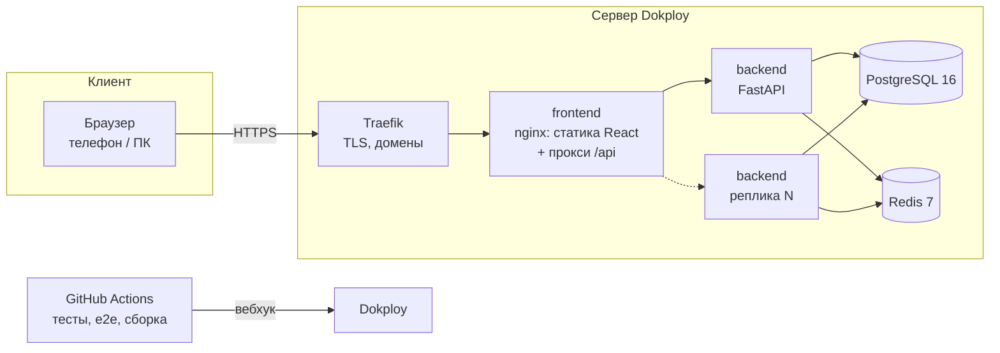
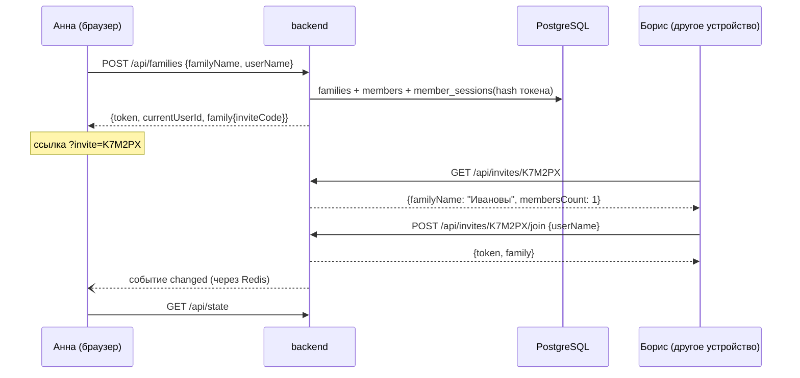

# Архитектура

Документ описывает, как устроен сервис «Семейный бюджет», почему он устроен именно так
и как будет расти. Справочник API — [API.md](API.md), запуск и настройки — [OPERATIONS.md](OPERATIONS.md),
работа с кодом и тестами — [DEVELOPMENT.md](DEVELOPMENT.md).

## 1. Что делает продукт

Семья ведёт общий бюджет на месяц:

| Понятие | Что это | Как влияет на расчёт |
|---|---|---|
| **Бюджет месяца** | Общая сумма плана и лимиты по 5 категориям: продукты, жильё, транспорт, дети, другое | Сумма лимитов не больше общей суммы; разница — «нераспределено» |
| **Расход** | Уже случившаяся трата: название, сумма, категория, дата, автор | Входит в «Потрачено» |
| **Обязательный платёж** | Будущая трата с датой (аренда, садик, коммуналка) | Пока не оплачен — «Зарезервировано»; после оплаты превращается в расход и учитывается один раз |
| **Проверка покупки** | «Можем ли купить X за N ₽?» | Сравнивает N со свободной суммой с учётом резерва и лимита категории |

Формулы (одни и те же на сервере и во фронтенде):

```
Потрачено          = Σ расходов месяца
Зарезервировано    = Σ неоплаченных платежей месяца
Осталось по плану  = План − Потрачено
Свободно по плану  = План − Потрачено − Зарезервировано
Статус категории   = no-limit (лимита нет) | no-spend (ничего не потрачено) | ok | near (≥ 85% лимита) | over (> 100%)
Вердикт покупки    = not-enough (свободного не хватит) | category-over (не хватит лимита категории)
                     | tight (останется < 5% плана) | ok
```

## 2. Компоненты



| Компонент | Технология | Ответственность | Состояние |
|---|---|---|---|
| frontend | React 19, Vite, Zustand; nginx 1.27 | Интерфейс; nginx раздаёт статику и проксирует `/api` на backend | Без состояния |
| backend | Python 3.12, FastAPI, SQLAlchemy 2 (async), uvicorn | Бизнес-правила, права доступа, валидация, расчёт месяца, события | Без состояния — масштабируется копиями |
| PostgreSQL | 16 | Единственный источник истины: семьи, участники, сессии, бюджеты, расходы, платежи | Данные, том `pgdata` |
| Redis | 7.4, без записи на диск | Счётчики лимитов запросов; рассылка событий между репликами (pub/sub) | Временное: потеря не ломает данные |

Почему такой стек: всё open source и работает в закрытом контуре без интернета (требование трека для решений
с клиентскими данными); PostgreSQL заменяется на Postgres Pro, Redis — на совместимый KeyDB/Valkey
без изменения кода.

### Слои бэкенда

```
backend/app/
  api/          HTTP: роуты, коды ответов, OpenAPI           ← тонкий слой, без правил
  services/     правила: права, валидация, транзакции         ← здесь логика продукта
  domain/       расчёт месяца и проверка покупки              ← чистые функции, без БД
  models.py     таблицы (SQLAlchemy)
  schemas.py    форма запросов и ответов (camelCase, как во фронтенде)
  validation.py проверки ввода с русскими сообщениями
  deps.py       аутентификация участника по токену
  ratelimit.py  лимиты запросов
  realtime.py   события «данные семьи изменились»
  middleware.py request-id, журнал запросов, рассылка событий
  maintenance.py фоновая очистка
```

Правило зависимостей: `api → services → domain/models`. Домен не знает про HTTP и БД, поэтому
его формулы проверяются быстрыми unit-тестами и совпадают с `frontend/src/domain/budget.ts`.

## 3. Ключевые сценарии

### Создание семьи и приглашение



### Синхронизация устройств

1. Каждое открытое приложение держит поток `GET /api/events` (Server-Sent Events).
2. Любой успешный изменяющий запрос (POST/PUT/DELETE со статусом < 400) после ответа публикует
   в Redis `family:<id>` событие `{"type": "changed", "by": <memberId>}`.
3. В каждой реплике бэкенда один общий подписчик (`PSUBSCRIBE family:*`) раздаёт событие локальным потокам этой семьи.
4. Клиент перечитывает `GET /api/state` (с задержкой 300 мс, чтобы склеить серию изменений).

В событии нет данных — только факт изменения, поэтому через него ничего не утекает, а клиент всегда
получает согласованное состояние из одного источника. Страховки: после переподключения клиент
перечитывает состояние; раз в 60 секунд — контрольный опрос; поток шлёт `: ping` каждые 15 секунд,
чтобы прокси не рвали простаивающее соединение.

Почему SSE, а не WebSocket: поток односторонний, работает поверх обычного HTTP через nginx/Traefik
без особой настройки и не требует отдельного протокола. Почему не просто опрос: изменение у другого
участника появляется за ~0,5 с вместо 20 с, и сервер не получает запрос `/state` от каждого клиента каждые 20 секунд.

### Отметка платежа оплаченным

`POST /api/payments/{id}/paid {"paid": true}` в одной транзакции блокирует строку платежа
(`SELECT … FOR UPDATE`), создаёт расход с `payment_id` и меняет статус. Если два участника нажмут
одновременно, второй увидит уже оплаченный платёж и ничего не создаст. `payment_id` у расходов
уникален — это последняя страховка от двойного учёта.

## 4. Модель данных

```mermaid
erDiagram
    families ||--o{ members : "участники"
    members ||--o{ member_sessions : "устройства"
    families ||--o{ budgets : "1 на месяц"
    families ||--o{ expenses : ""
    families ||--o{ payments : ""
    payments |o--o| expenses : "оплачен → расход"
    members |o--o{ expenses : "автор"
    members |o--o{ payments : "автор"

    families { string id PK; string name; string invite_code UK; bool is_demo; bigint created_at }
    members { string id PK; string family_id FK; string name; string color; bigint joined_at; bigint left_at }
    member_sessions { string token_hash PK; string member_id FK; bigint created_at; bigint last_seen_at }
    budgets { string family_id PK; string month_key PK; bigint total_kop; json category_plans_kop; bigint updated_at; string updated_by }
    expenses { string id PK; string family_id FK; string title; bigint amount_kop; string category; date date; string author_id; string payment_id UK; bigint created_at }
    payments { string id PK; string family_id FK; string title; bigint amount_kop; string category; date due_date; string status; string author_id; bigint created_at }
    idempotency_records { string scope PK; string key PK; string fingerprint; json response; bigint created_at }
```

Таблицы второй очереди (правила — [FEATURES.md](FEATURES.md)):

| Таблица | Что хранит |
|---|---|
| `members.role`, `members.status`, `families.child_invite_code` | Роли parent/child; подтверждение входа (`active`/`pending`); постоянный детский код. `child_invites` — старые одноразовые приглашения |
| `allowances` | Карманные деньги ребёнка: сумма и период |
| `purchase_requests` | Запросы на покупку и решения; `expenses.request_id` — созданный расход |
| `goals`, `goal_contributions` | Цели-копилки и взносы |
| `payments.recurring / series_id / series_month` | Серии повторяющихся платежей, уникально (серия, месяц) |
| `expenses.paid_by`, `settlements` | Кто платил; отмеченные переводы между взрослыми |
| `expenses.receipt_key`, `expenses.import_fingerprint` | Защита от повторного чека и повторной строки выписки (уникально в семье) |
| `notifications`, `email_outbox`, поля `members.email*` | Уведомления, очередь писем, подтверждённый адрес |
| `statement_imports`, `import_rows`, `category_rules` | Загруженные выписки до подтверждения; запомненные категории семьи |
| `members.oidc_sub` | Привязка к учётной записи ВТБ ID |

Фоновые задачи (`maintenance.py`, раз в час, безопасны на нескольких копиях): очистка устаревших записей,
продление серий платежей, напоминания о платежах; отдельный цикл разбирает очередь писем (`SKIP LOCKED`).

Решения и их причины:

| Решение | Почему |
|---|---|
| Деньги — целые копейки (`BIGINT`), в API — рубли (`1250.5`) | Сумма `0.1 + 0.2` должна быть `0.3`, а не `0.30000000000000004` |
| Время — миллисекунды Unix (`BIGINT`), даты — `DATE` | Так их отдаёт и ждёт фронтенд; часовой пояс «сегодня» задаётся `TIMEZONE` |
| Лимиты категорий — JSON в строке бюджета | Набор категорий фиксирован, бюджет читается и пишется целиком |
| Участник после выхода не удаляется (`left_at`) | У его расходов остаётся автор |
| Всё удаляется каскадом от семьи (`ON DELETE CASCADE`) | Удаление семьи (последний участник вышел, истекло демо) не оставляет мусора |
| Индексы `(family_id, date)` и `(family_id, due_date)` | Все выборки — «данные семьи за месяц» |
| ID — UUID строкой | Не раскрывают количество записей, генерируются без обращения к БД |

Схема ведётся миграциями Alembic (`backend/migrations/versions`); контейнер применяет их при старте.

## 5. Безопасность

Кратко — ниже; модель угроз, защита от DDoS по уровням, результаты аудита и остаточные риски —
в [SECURITY.md](SECURITY.md).

| Угроза | Защита |
|---|---|
| Доступ к чужой семье | Каждый запрос фильтруется по `family_id` участника из токена; чужие объекты отвечают как несуществующие (404). Покрыто тестом `test_families_are_isolated` |
| Кража базы | В базе только SHA-256 токенов. Персональные данные — только имя, которое человек ввёл сам |
| Перебор кодов приглашения | Код из 6 символов алфавита без похожих букв (32⁶ ≈ 10⁹ вариантов) + лимит 20 попыток в минуту с IP |
| Массовое создание семей | Лимит 10 созданий семей/демо в минуту с IP |
| Подмена IP в `X-Forwarded-For` | Заголовку верим только от прокси из частных сетей (`FORWARDED_ALLOW_IPS`); IP берётся справа налево до первого недоверенного |
| Двойная отправка формы | `Idempotency-Key`: повтор получает исходный ответ, другое тело с тем же ключом — 409 |
| Гонки двух участников | Атомарный upsert бюджета, блокировка строки при оплате, уникальный `payment_id`; оставшиеся конфликты — 409, а не 500 |
| Вечные сессии | Сессия закрывается после 90 дней без запросов; выход из семьи закрывает все сессии участника |
| Межсайтовые запросы | CORS только для доменов из `CORS_ORIGINS`; токен в заголовке, а не в cookie — CSRF неприменим |
| Утечки в логах | Журнал пишет метод, путь, статус, время и IP; тела запросов и токены не пишутся |

Соответствие требованиям банка на этапе пилота:

- **152-ФЗ.** Хранится только имя, введённое пользователем; нет телефонов, паспортных данных, номеров карт.
  При интеграции с банком — хранение в РФ, в контуре банка, с вводом согласия на обработку.
- **On-prem.** Нет обращений во внешние сервисы; всё разворачивается в закрытом контуре.
- **Аутентификация.** Токен устройства закрывает сценарий хакатона; в пилоте заменяется
  на вход через ВТБ Онлайн (OIDC), `members` связывается с идентификатором клиента банка.

## 6. Надёжность и масштабирование

### Сейчас (один сервер Dokploy)

```
Traefik → frontend(nginx) → backend × N → PostgreSQL
                                        → Redis
```

- Бэкенд без состояния: сессии, идемпотентность и бизнес-данные — в PostgreSQL, счётчики и события — в Redis.
  Поэтому копий может быть несколько: `docker compose up --scale backend=N` или `deploy.replicas` в compose.
  nginx через DNS Docker распределяет запросы между копиями. Работа двух реплик проверяется в CI
  (`docker-compose.e2e.yml`, `scale: 2`).
- Миграции выполняются при старте контейнера и безопасны при одновременном старте реплик
  (`pg_advisory_xact_lock` в `migrations/env.py`: вторая копия ждёт первую и видит, что применять нечего).
- Фоновая очистка идемпотентна, её можно выполнять во всех репликах одновременно.
- PostgreSQL и Redis — в отдельной внутренней сети Docker без выхода наружу; nginx в неё не входит.

Оценка ёмкости одной копии бэкенда: сотни запросов в секунду на простых чтениях, тысячи открытых
SSE-потоков (asyncio, поток не держит соединение с БД). Пул БД — 10 + 20 соединений на копию;
у PostgreSQL по умолчанию `max_connections = 100`, поэтому больше трёх копий — только через PgBouncer.

### Целевая архитектура пилота (контур банка)

| Что | Когда понадобится | Как |
|---|---|---|
| Балансировщик + автоматическое создание копий | Нагрузка не помещается в одну машину или нужна отказоустойчивость | Kubernetes/OpenShift: `Deployment` бэкенда + `HorizontalPodAutoscaler` по CPU/числу запросов; readiness — `GET /api/ready`, liveness — `GET /health`. В Dokploy — режим Swarm с `replicas` |
| PgBouncer | Больше 3 копий бэкенда | transaction pooling перед PostgreSQL |
| Отказоустойчивый PostgreSQL | Пилот с реальными клиентами | Patroni / управляемый Postgres Pro в контуре банка, реплика для чтения, ежедневные бэкапы с PITR |
| Redis Sentinel / кластер | Несколько копий бэкенда в проде | Потеря Redis не теряет данные: клиенты переходят на контрольный опрос раз в 60 с, лимиты временно не действуют |
| S3-совместимое хранилище (MinIO) | Появятся файлы: фото чеков, выгрузки, аватары | Файлы в бакете, в БД — только ключ; выдача через presigned URL. Сейчас файлов в продукте нет, поэтому хранилище не разворачиваем |
| Очередь фоновых задач | Напоминания о платежах, импорт выписок | Redis Streams или RabbitMQ + отдельный воркер на том же образе |
| Мониторинг | Пилот | Prometheus-метрики (`/metrics`), Grafana, сбор JSON-логов (Loki/ELK) по `request_id` |

## 7. Решения, от которых отказались

| Вариант | Почему нет |
|---|---|
| Считать сводку только на фронтенде | Нужна для будущих каналов (уведомления, чат-бот, банковское приложение) — сервер считает так же |
| WebSocket для синхронизации | Поток односторонний; SSE проще проходит через прокси и не требует отдельного протокола |
| Хранить данные в Redis | Это не источник истины: в Redis только то, что можно потерять |
| Пароли и регистрация | Лишний барьер на хакатоне; в пилоте вход будет через банк |
| S3 и очередь задач «на будущее» | Нет сценария, который бы их использовал; добавляются, когда появится функция |
